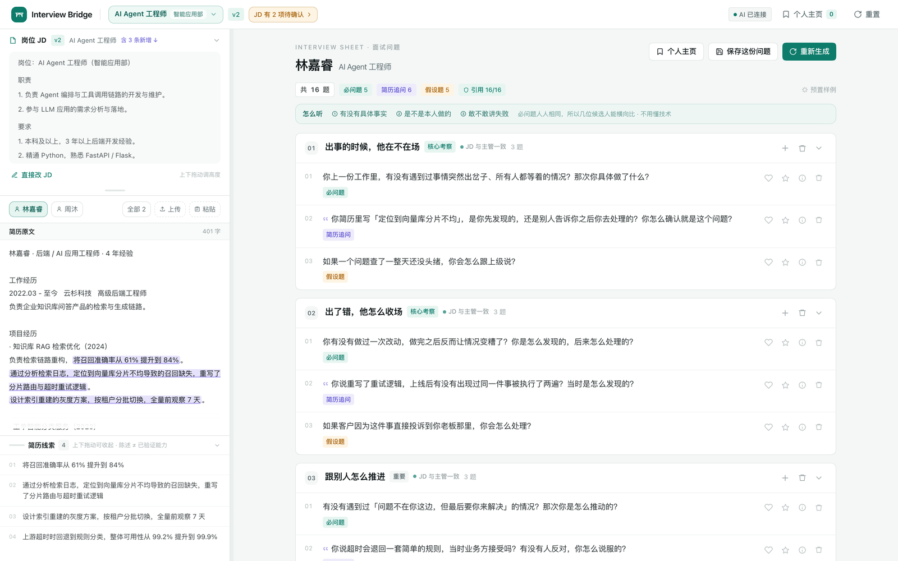
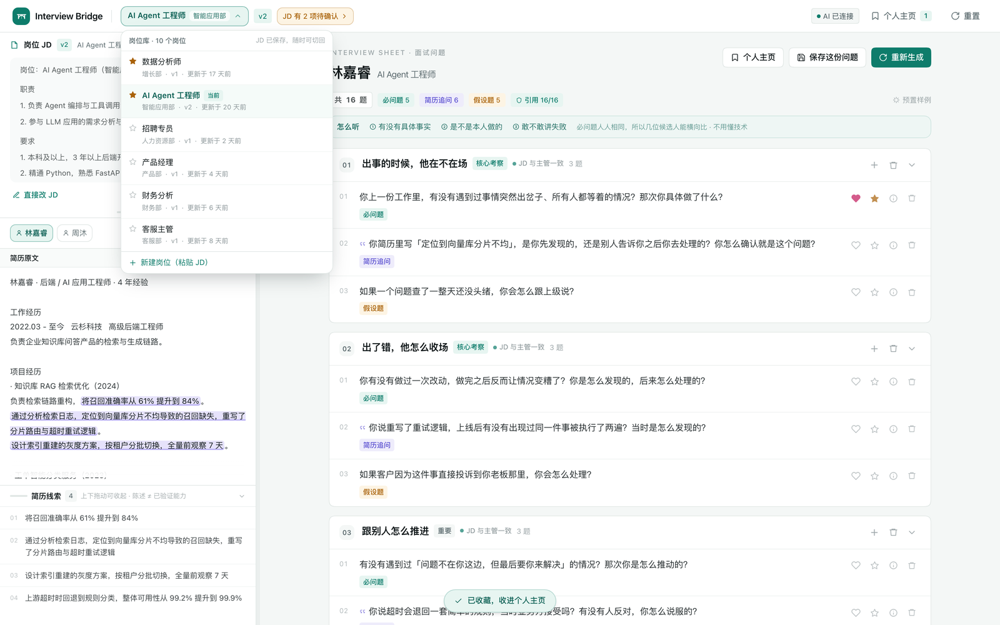
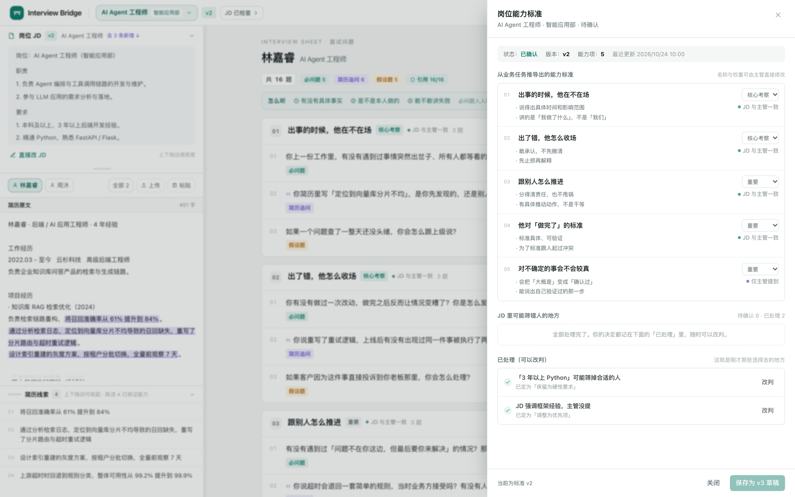
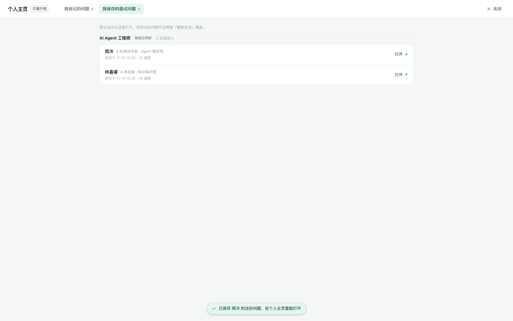
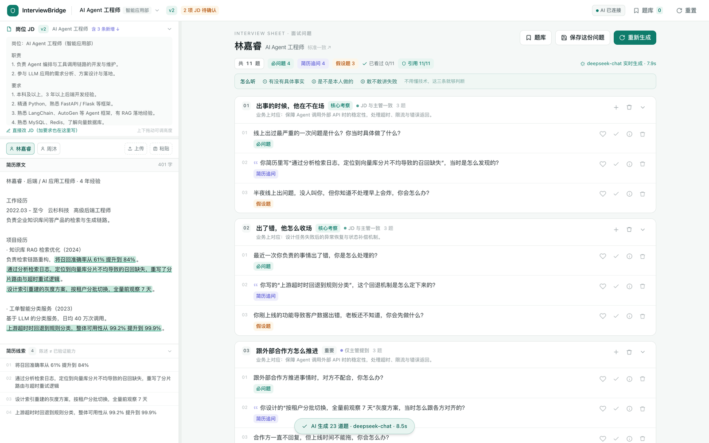

<div align="center">

# Interview Bridge

**让不懂技术的 HR，也能为一群业务岗位招到对的人。**

把业务主管口中的「要能定位线上故障」，翻译成 HR 问得出、听得懂、判得了的行为问题。

<sub>React 19 · Vite 7 · TypeScript · Tailwind 4 · DeepSeek（可选）</sub>

[**▶ 在线演示**](https://hanny-0303.github.io/interview-bridge/) ·
[**🎬 32 秒产品片**](docs/media/interview-bridge-intro-v2.mp4) ·
[三分钟演示脚本](#三分钟演示) ·
[快速开始](#快速开始)

<br>



</div>

> 单页双栏：**左栏是岗位与候选人（JD、简历），右栏是这个人专属的一页面试问题**。中间分界线可以左右拖动。
> 内置 **10 个部门岗位 × 2 位候选人**（市场、运营、销售、客服、财务、产品、前端、人力、增长、智能应用），全部为虚构演示数据。

---

## 60 秒看懂

技术面试官不缺题，缺的是**把业务要求翻译成面试动作**的那一层。业务主管说「这个人要能自己扛线上故障」，落到 HR 手上只剩一句 JD；HR 只能问「你平时怎么排查问题」，得到的也是套话。

这个产品做的不是「生成问题」，而是**把一条需求一路接到一道题上**，并且每一环都能点开看依据：

```
业务任务  ──▶  能力维度  ──▶  简历原文  ──▶  面试问题
（主管说的）    （拆出来的）    （HR 看到的）    （HR 问出的）
```

四级证据链，点任意一道题都能退回去看它为什么存在。

> **一句话**：技术判断留给业务主管，HR 面只看三件事——**有没有具体事实、是不是本人做的、敢不敢讲失败**。

---

## 先看片（第二版）

32 秒，1920×1080，像素办公室风格。片子讲的是上面那条链路断在哪、又怎么接上：

[](docs/media/interview-bridge-intro-v2.mp4)

<sub>点海报播放完整视频（18 MB），或直接下载 [interview-bridge-intro-v2.mp4](docs/media/interview-bridge-intro-v2.mp4)。</sub>


<sub>片段：产品界面三块能力——岗位需求对齐 / 候选人经历映射 / 面试作战卡。</sub>

---

## 三个对象

产品的数据模型只有三层，所有交互都挂在这上面：

```
岗位（JD + 版本 + 收藏）
  └── 候选人（简历 + 线索）
        └── 面试问题（提前生成、可保存的一份）
```

| 对象 | 你能做什么 |
| --- | --- |
| **岗位** | 顶栏点开岗位库：收藏置顶、最近更新排序、粘贴 JD 一键新建。JD 就在左栏第一块，**可以直接改**；改过的行自动标「新增」，和建岗原文比对得出 |
| **候选人** | PDF / DOCX / TXT 或直接粘贴；挂在当前岗位下；按最新添加 / 最近更新 / 第一学历 / 毕业时间排序；可删除（连保存的问题一起，二次确认） |
| **面试问题** | 必问题（同岗位完全一致）、简历追问（带引号、可追原文）、假设题；可拖拽排序、可跨模块移动；喜欢 ♡ 与收藏 ★ 互相独立 |

**保存这件事是刻意的**：面试前几天生成、改到满意、点「保存这份问题」；面试当天切回岗位、点名字，打开就是那一份。之后再生成**不会静默覆盖**——顶部提示「当前内容有改动」，给你「恢复已保存」和「保存更新」。

---

## 界面

| | |
| --- | --- |
| <br>**岗位库**：10 个岗位，收藏置顶，切回来 JD 和候选人都在 | <br>**JD 检查**：哪些要求可能筛错人，处理完的决定还能改判 |
| <br>**个人主页**：标记过的问题 + 为每位候选人保存的问题 | <br>**真实生成**：deepseek-chat，23 道题 8.5 秒 |

另外两个抽屉也值得点：**全部候选人**（排序 / 打开 / 删除）、**证据链**（四级跳转）。

---

## 问题为什么这样写

HR 判断不了技术答案对不对，所以这套题不看对错，只看三件事——这行字就印在每份清单最上面，叫「怎么听」：

> **① 有没有具体事实　② 是不是本人做的　③ 敢不敢讲失败**

同一句业务要求，翻译前后差多少：

| 业务语言（主管说的） | 翻译成 HR 能问的 |
| --- | --- |
| 要能定位线上故障、切分边界 | 你上一份工作里，有没有遇到过系统突然出问题、所有人都在等的情况？那次你具体做了什么？ |
| 要设计异常恢复机制 | 你有没有做过一次改动，上线之后反而让情况变糟了？你是怎么发现的，后来怎么处理的？ |
| 要能对线上可靠性负责 | 你判断一件事「可以上线了」的标准是什么？举一个你坚持要再等等的例子。 |

还有一类**翻译题**只有看着简历才出得来：

> 「你简历里写『幂等键』，能用不涉及技术的话讲一下它解决的是什么问题吗？」

HR 不需要知道答案，只需要判断对方能不能讲清楚。讲不清通常意味着：不是他做的，或者他没想过。

---

## 模型接在哪

```
浏览器 ──POST /api/card──▶ server.mjs(:8787) ──▶ api.deepseek.com
                              │
                              └─ 引用校验：不过的直接丢掉
```

- 密钥只在服务端，`.env` 已进 `.gitignore`
- 没配密钥也能完整演示：走预置样例，标注「预置样例 · 模型不可用」
- **全量降级**：一位候选人失败就两位一起退回预置，避免「一位实时一位预置」破坏必问题的一致性
- 服务端丢弃四类输出：能力 ID 不存在、追问引用的简历原文命中不了、必问题偷偷引用简历、重复或超长

**实测（deepseek-chat）**：两位候选人共 23 道题，8.5 秒，0 条被丢弃，约 5.8k tokens。日志一行 `✓12 ✗3` 就能看出这次丢了几条。

### 一个必须存在的后处理：跨候选人对齐

模型是逐位候选人独立生成的，措辞必然飘。同样针对「出事的时候他在不在场」：

- 林嘉睿拿到：`最近一次线上出问题，你当时在做什么？`
- 周沐拿到：`你最近一次线上出问题是什么时候？你当时做了什么？`

不处理，「同岗位问同一道题」就只是口号。`lib/canonical.ts` 在每个 `能力 × 题型` 上只保留第一个出现的版本，其余全部覆盖，模型漏掉的还会补齐。

> 这是**保证**，不是美化——必问题的一致性由代码兜底，不指望模型自觉。

---

## 快速开始

```bash
cp .env.example .env     # 可选：填 DEEPSEEK_API_KEY
./dev.sh                 # 前端 5178 + 模型服务 8787
```

打开 <http://localhost:5178>。生产构建 `pnpm build`，首屏 98 kB gzip，PDF / DOCX 解析按需加载。

> **在线演示**用的是静态托管版，没有后端，所以顶栏显示「离线样例 · 静态演示」；点「重新生成」会用预置样例重新组卷，不调用模型。

---

## 三分钟演示

<details>
<summary><b>展开演示脚本（对着屏幕念也行）</b></summary>

**开场（15 秒）**：HR 不懂技术，却要给技术岗位招人。她手上只有 JD，而业务主管真正在意的，经常是 JD 上没写的那几句。

**第一幕 · 岗位库（40 秒）**
点开顶栏岗位：两个岗位摆着，AI Agent 那个被收藏置顶。切到「数据分析师」，是另一个岗位的空状态；切回来，林嘉睿、周沐都在。**JD 存得住，面试才接得上。**

**第二幕 · 改 JD（35 秒）**
左栏 JD 末尾三条淡色「新增」——主管口头说的，HR 自己敲进去的。点「直接改 JD」，再加一条「有过线上值班经验」，保存。标题变 v3，右栏黄条提示「JD 已更新，这份问题还是 v2」。

**第三幕 · 上传（40 秒）**
上传一份 PDF 简历。原文铺开、句子高亮、线索列表冒出来。右边已经是一页 12 道题：必问题、简历追问、假设题。

**第四幕 · 这题为什么问（45 秒）**
点简历里「接口超时率从 1.2% 降到 0.2%」，右边对应追问闪一下。点开依据：业务任务 → 能力维度 → 这句简历原文 → 本题。再点最上面那道必问题——它不引用任何简历，所以两位候选人问的是同一句。

**第五幕 · 保存（30 秒）**
删掉一道不需要的，点「保存这份问题」。用黄条演示「改过之后不会静默覆盖」：删一道，黄条变「当前内容有改动」，点「恢复已保存」就回来了。

**收尾（10 秒）**：「她不需要懂技术，也能问出一场像样的面试。」

</details>

---

## 目录

<details>
<summary><b>展开文件结构</b></summary>

```
src/
  App.tsx                        布局 / 分栏拖动 / 状态 / 抽屉
  data/mock.ts                   两个岗位、两位样本、题目模板、通用追问
  data/types.ts                  JobProfile · Competency · ResumeClaim · Question
  lib/resume.ts                  PDF/DOCX/TXT 解析 + 规则线索抽取
  lib/store.ts                   reducer：岗位切换、改 JD、保存面试卡、收藏
  lib/api.ts                     调用 /api/card，失败自动降级
  lib/state.ts                   localStorage（带结构版本号，旧数据自动丢弃）
  lib/canonical.ts               跨候选人把必问题 / 假设题对齐成同一句
  components/JobSwitcher.tsx     岗位库下拉
  components/LeftPanel.tsx       JD（可拖高、标新增）+ 候选人 + 简历 + 线索
  components/CardPanel.tsx       一页问题：必问题 / 追问 / 假设题 + 拖拽 + 喜欢收藏
  components/ProfileDrawer.tsx   个人主页：标记的问题 + 保存的面试问题
  components/CandidateDrawer.tsx 全部候选人：排序 / 打开 / 删除
  components/Burst.tsx           喜欢、收藏的点击爆散
  components/StandardPanel.tsx   能力维度与 JD 待确认项
  components/EvidenceDrawer.tsx  四级证据链
  components/LibraryDrawer.tsx   题库（跨候选人复用）
server.mjs                       模型服务：HR 面提示词 + 引用校验
docs/media/                      产品前导片（第二版）、海报、动图
```

</details>

---

## 边界

这不是「AI 面试官」，也不打算是：

- **不做技术题**——技术判断留给业务主管，HR 面只验行为事实
- **不做匹配度分数、不做自动淘汰**——分数会让人偷懒，这层判断不该被一个数字替代
- **不做实时语音面试**——先把「问什么」解决清楚，再谈怎么问
- **线索抽取是规则版**（动作词 + 量化结果 + 短板句），离线可用、可解释，接模型后会替换

上传简历若没有预置追问，会按句子类型生成通用追问（定位型 / 方案型 / 指标型 / 短板型），并标注「配置模型后替换为定制问题」。

---

<div align="center">
<sub>一个人的招聘工具 · 所有数据均为虚构演示<br>
<a href="https://hanny-0303.github.io/interview-bridge/">在线演示</a> ·
<a href="docs/media/interview-bridge-intro-v2.mp4">产品片</a> ·
<a href="https://github.com/Hanny-0303/interview-bridge/issues">提 Issue</a></sub>
</div>
